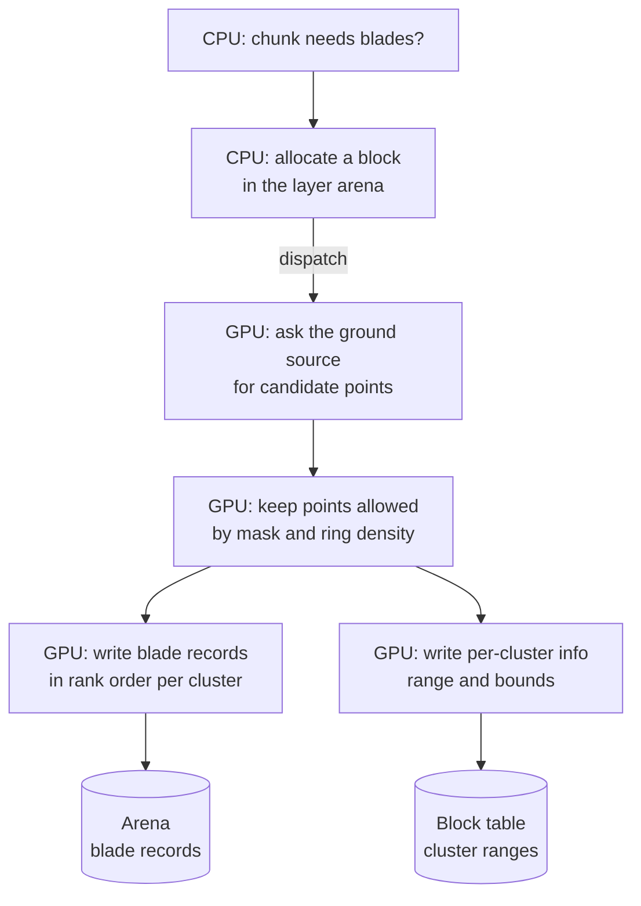
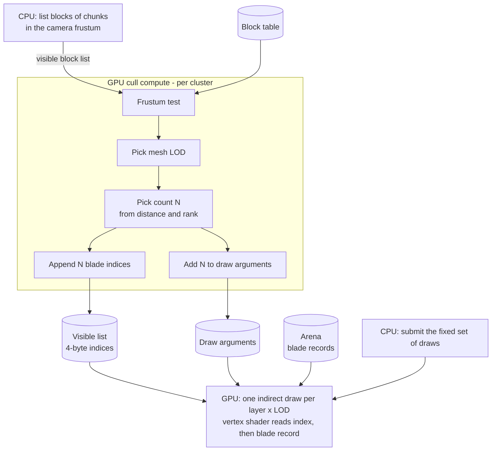

# GPU Scatter Prototype - Design Document

| | |
|---|---|
| Engine | Unity 6.6 (6000.6.10f1), URP 17.6, **Forward+** renderer |
| Platform | Desktop PC, DX12 (Vulkan checked), compute shaders required |
| GPUs | Test: RTX 3060 Ti. Target: RTX 5070 Ti. Reference resolution 1440p |
| Purpose | Validate a GPU-driven procedural scatter system (grass, flowers, moss, small rocks, bushes) on terrain and meshes, with wind, player interaction and shadows, usable in a streamed open world. Measure it to choose the production architecture. |

---

## 1. Goals

| ID | Goal |
|---|---|
| G1 | **Performance in a real open world.** RTX 3060 Ti: whole frame >= 60 FPS, scatter GPU time <= 2.5 ms. RTX 5070 Ti: whole frame >= 90-120 FPS, scatter GPU time <= 2 ms. Quality tiers scale between the two. |
| G2 | **One pipeline for terrain and meshes.** They differ only in how candidate points are produced. |
| G3 | **Animation and interaction.** Wind with gusts, per-blade variation, bending/flattening by the player and objects, with recovery. |
| G4 | **BatchRendererGroup (BRG) rendering**, with `Graphics.RenderMeshIndirect` as a simpler baseline for comparison. |
| G5 | **URP integration.** Lighting, shadow receiving, shadow casting configurable per layer, depth/normal/motion-vector passes, no pipeline fork. |
| G6 | **Multiple scatter layers.** Several grass types, flowers, moss, small rocks, bushes. |
| G7 | **Works with any streamed, hierarchical-LOD terrain** through a small adapter (4.4), without depending on the terrain code, whatever its tile size or LOD scheme. |

**Non-goals:** mobile/console, VR, moving or deforming ground (future improvement), large objects (houses, trees, big rocks: handled by a separate streamed system, see 9.2), grass physics.

---

## 2. Vocabulary

Terms are grouped by theme. The section in brackets gives the details.

**Content**
| Term | Definition |
|---|---|
| **Blade** | One scattered instance (a grass blade, a flower, a pebble...). Called "blade" for all layers. (7) |
| **Layer** | One kind of blade: mesh LODs, material, density, size, wind, shadows... (7) |
| **Ground source** | The terrain (through its adapter) or a mesh: something that can produce candidate points on its surface. (4) |
| **Terrain adapter** | Small class, written once per terrain system, that lets the scatter system read the terrain without depending on its code. (4.4) |
| **Ground patch** | Small textures (height, masks, albedo) covering one chunk, filled by the terrain adapter before generation. (4.1) |
| **Candidate point** | A possible blade position on a ground source, before the mask and density decide whether it becomes a blade. (4.1, 4.2) |
| **Mask** | Texture saying how dense each layer is on a ground source. (4.3) |
| **Scatter profile** | Asset attached to a ground source: which layers it receives and which mask channel drives each. (4.3) |
| **Density** | Fraction (0 to 1) of a layer's full blade count that is kept. Decreases with distance, following the layer's density curve. (5.2, 5.3) |
| **Rank** | A fixed per-blade number in [0,1) deciding which blades are removed first when density decreases (lowest ranks are kept). (5.2) |
| **Mesh LOD** | Simpler blade mesh used at distance (e.g. 7, 5, 3 vertices). Not to be confused with rings. (6.2, 7) |

**Space**
| Term | Definition |
|---|---|
| **Chunk** | A 32 m x 32 m square of a fixed world grid, independent of terrain tiles. Unit of **streaming and generation**. (5.1) |
| **Cluster** | An 8 m x 8 m sub-square of a chunk (16 per chunk). Unit of **culling and LOD decision**. (6.2) |
| **Ring** | Distance band around the camera (e.g. 0-30 m, 30-80 m, 80-200 m). Decides how many blades a chunk **stores**. (5.3) |
| **Scatter range** | Maximum distance at which a layer exists (e.g. 200 m). Beyond it, chunks are released. (5.1, 7) |
| **Residency** | Whether a ground source's data for an area is loaded and matches the rendered surface. Blades are generated only on resident ground. (4.4) |

**GPU data**
| Term | Definition |
|---|---|
| **Blade record** | The 16 bytes describing one blade: position, normal, rank, size, rotation, variant. Written at generation, read by the vertex shader. (5.5) |
| **Arena** | One large GPU buffer per layer, holding the blade records of all blocks of that layer. (5.4) |
| **Block** | The part of the arena holding the blade records of one (chunk, layer, ground source). Comes in a few fixed sizes ("block classes"). (5.4) |
| **Cluster range** | The part of a block holding one cluster's blade records, sorted by rank. (5.4) |
| **Block table** | Small GPU buffer describing each block: chunk origin, bounds, and its 16 cluster ranges. (5.4) |
| **Visible list** | Per-frame GPU buffer of 4-byte blade indices to draw, one region per layer x mesh LOD. (6.2) |
| **Draw arguments** | Small GPU buffer holding, per draw, the number of blades to draw. Written by the cull compute. (6.2, 6.3) |

**Processing**
| Term | Definition |
|---|---|
| **Generation** (placer compute) | GPU pass turning candidate points into blade records for one block. Runs only when a chunk needs it. (3, 4, 5.1) |
| **Cull compute** | Per-frame GPU pass deciding, per cluster, visibility, mesh LOD and blade count, and filling the visible list and draw arguments. (6.2) |
| **Indirect draw** | A draw whose instance count is read from the draw arguments on the GPU, so the CPU never needs to know it. (6.3) |
| **Interaction texture** | Top-down texture around the player storing how blades are pushed and flattened. (8.4) |
| **Quality tier** | Set of settings (density, ranges, shadows) per GPU class: RTX 3060 Ti, RTX 5070 Ti. (1, 12) |
| **Debug HUD** | On-screen panel of timings, blade counts, memory, streaming state and warnings, with debug views and controls. (12.1, 12.2) |

Sizes (32 m, 8 m, ring distances) are tunable settings; the values above are starting points.

---

## 3. How it works (overview)

The system runs in two stages. The CPU never waits for GPU results (no GPU readback).

### Stage A - Generation
Runs only when a chunk appears, gets closer to the camera, or its ground changes.



### Stage B - Every frame



Key points:
- **Blades are generated on the GPU and stay there.** The CPU only manages chunks and submits a fixed number of draws.
- **Generation is rare, culling is cheap.** Culling works on clusters (a few thousand), not on blades (millions).
- **The visible list contains indices, not copies.** The cull writes 4 bytes per visible blade; the vertex shader reads the blade record from the arena through that index.
- **The number of draw commands is fixed:** one per layer x LOD (x shadow/depth passes), whatever the number of chunks or clusters.

---

## 4. Ground sources

### 4.1 Terrain ground source
The scatter system never reads terrain tiles directly. Before generating a chunk, it asks the **terrain adapter** (4.4) to copy the terrain data of the chunk area into a **ground patch**, a small set of textures owned by the scatter system:

| Patch texture | Format | Content |
|---|---|---|
| Height | R32F | World-space Y |
| Masks | RGBA8 texture array | The mask channels requested by the scatter profiles (4.3), 0 to 1 |
| Albedo (optional) | RGBA8 | Terrain colour, for the root tint (8.2) |

The patch covers the chunk plus a one-texel border (for normals at the edge). Its spacing is a setting, by default the terrain's finest spacing: at 0.25 m, 131 x 131 texels, about 70 KB of height. A few patches are allocated at startup (one per generation in flight) and reused.

Producing candidate points for a chunk:
1. The adapter fills the ground patch for the chunk area (GPU copy, no readback).
2. For each cluster, walk a **progressive low-discrepancy sequence** of points in XZ (e.g. R2 sequence seeded by the cluster world coordinates). The index of a point in the sequence gives its rank: any prefix of the sequence is evenly spread.
3. For each point: sample the patch height, compute the normal from the height gradient, sample the masks.
4. Valid because a heightmap has exactly one height per XZ.

Because the patch is in world coordinates, the terrain's tile size, tile layout, LOD scheme and texture storage (separate textures, arrays, atlas, virtual texturing) are invisible to the rest of the system.

### 4.2 Mesh ground source
Placed on a static mesh. Positions are **not** browsed in XZ: a mesh can be a sphere, a cliff or an overhang.

- **Editor bake:** sample the surface over the triangles (more samples on larger triangles, multiplied by the mask), store world position + normal per sample, per layer. Samples cover the whole surface, all around a sphere.
- Samples are binned by chunk and cluster, and ordered so that any prefix is evenly spread (this order defines the rank).
- **Runtime:** the baked samples are uploaded to a GPU buffer when the mesh is loaded (the mesh source is resident once this is done; loading and unloading raise `Changed`, 4.4). Generating a chunk copies the samples of that chunk whose rank passes the ring's density into the block.
- The chunk grid is 2D (XZ); a cluster's vertical bounds are taken from the actual content, so tall or vertical meshes work.

### 4.3 Masks and layer assignment
Each ground source has a **scatter profile** asset: the list of layers placed on it and the mask channel that drives each one.
- **Terrain:** mask channels come from the terrain through its adapter (e.g. the terrain's splat weights or dedicated scatter masks). The scatter profile maps each layer to a terrain channel index. Layers may add slope and altitude limits.
- **Mesh:** a mask texture through the mesh's UVs (needs unique, non-overlapping UVs), or vertex colours for coarse control. Read at bake time.
- Where a mesh sits on terrain (a rock), the terrain mask is painted to exclude the area for layers that should not appear twice.

### 4.4 Streaming and the terrain adapter
Every ground source (terrain or mesh) exposes:
- `IsResident(area)`: its data for this world area is loaded and final.
- `Changed(area)` event: its data for this area changed (loaded, unloaded, LOD switch, edit).

**Terrain adapter.** The scatter system is a package with no dependency on any terrain code. A terrain system is connected by implementing one interface:

```csharp
public interface ITerrainAdapter
{
    bool IsResident(Rect areaXZ);              // whole area loaded and meeting contract rule 1
    event Action<Rect> Changed;                // raised on the main thread
    void FillPatch(CommandBuffer cmd, in GroundPatchRequest request);
}

public struct GroundPatchRequest
{
    public Rect areaXZ;           // chunk area + border, world space
    public int resolution;        // texels per side
    public RenderTexture height;  // R32F, world-space Y
    public RenderTexture masks;   // RGBA8 Texture2DArray, 4 channels per slice
    public RenderTexture albedo;  // RGBA8, null if not requested
    public int[] maskChannels;    // terrain channel index for each output channel
}
```

Adapter contract:
1. **Heights match the rendered surface** inside the scatter range, within a tolerance (e.g. 2 cm). The simplest way: the terrain renders its finest LOD inside the scatter range (~200 m). If it renders a coarser LOD there, the adapter fills the heights of the LOD actually rendered and raises `Changed` when it switches. Geomorphing cannot be matched exactly: keep morph zones beyond the near rings.
2. `IsResident(area)` is true only when the whole area is covered by data meeting rule 1.
3. `Changed(area)` is raised whenever what `FillPatch` would write for that area changes, and not for unrelated LOD changes.
4. `FillPatch` only records GPU commands (blit or compute) into the given command buffer: no readback, no allocation, no waiting.
5. The adapter works in the same world space as the scatter system, including after floating-origin shifts.

Rules on the scatter side:
- A chunk is generated only if every ground source overlapping it is resident.
- On `Changed(area)`: overlapping chunks are queued for regeneration and keep drawing their current blocks until replaced. If the area is no longer resident, their blocks are released.
- A chunk overlapping several terrain tiles, even at different LODs, is still one `FillPatch` call. The adapter handles the tile seams.

**Integration in another project:** import the scatter package, write one adapter class (typically a small compute shader sampling the terrain textures, plus forwarding the streaming events), and validate it with the adapter checker and the adapter contract tests (Implementation Phase 4).

---

## 5. Chunks, rings and memory

### 5.1 Chunk lifecycle
| Event | Action |
|---|---|
| Chunk enters scatter range | Queue generation |
| Camera gets closer, chunk enters a denser ring | Queue regeneration at the higher density |
| Camera moves away, chunk enters a sparser ring | Nothing: the per-frame cull already draws fewer blades. The block is shrunk later if memory is needed (5.4). |
| Chunk leaves range (+ hysteresis) | Release its blocks |
| Ground `Changed`, area still resident | Queue regeneration; current blocks keep drawing until replaced (4.4) |
| Ground no longer resident | Release its blocks |

- The generation queue is **sorted by distance** and limited to a budget per frame (e.g. a few chunks). If the camera moves fast, far chunks wait; a chunk keeps drawing its previous, sparser blocks until regenerated.
- Placement is **deterministic** (from world coordinates, layer and source), so a regenerated chunk is identical to the previous one: no visual change other than added blades.

### 5.2 Rank: how blades are thinned with distance
Far away we draw fewer blades ("thinning"). The rank decides **which** blades are removed.

**Rank:** every blade receives, at generation, a number between 0 and 1. It never changes.

**Rule:** to keep a fraction `d` of the blades (the density), keep exactly the blades with `rank < d`.

Example, a cluster with 8 blades:

| Blade | A | B | C | D | E | F | G | H |
|---|---|---|---|---|---|---|---|---|
| Rank | 0.02 | 0.71 | 0.18 | 0.45 | 0.09 | 0.93 | 0.33 | 0.60 |

| Distance | Density `d` | Blades kept |
|---|---|---|
| Near | 100% | all 8 |
| Medium | 50% | A, C, D, E, G |
| Far | 20% | A, C, E |

Why this rule:
- **No popping:** moving away, blades disappear one by one in rank order; moving closer, they reappear in reverse order. Blades that stay never move.
- **Subset property:** the far set is always included in the near set. A chunk generated sparse is exactly a part of the same chunk generated dense, so regenerating it closer only adds blades.
- **Smooth fade:** a blade whose rank is close to `d` is shrunk in the vertex shader, so it fades out instead of vanishing (6.4).
- **Even spread:** ranks come from the order of a low-discrepancy sequence (4.1) or of the baked mesh samples (4.2), not from pure randomness. The kept blades stay evenly spread, without holes or clumps.
- **Cheap:** blades are stored in rank order inside each cluster, so "keep `rank < d`" means "draw the first N blades of the cluster".

### 5.3 Rings: how much a chunk stores
Each layer defines a density curve over distance (e.g. 100% up to 30 m, 25% at 80 m, 6% at 200 m) and ring boundaries.
- At generation, a chunk stores the blades with `rank < density` of the ring its nearest point is in.
- Every frame, the cull draws from that stored set only the blades needed at the actual distance (6.2). Moving away needs no regeneration; moving into a denser ring regenerates the chunk, which only adds blades (subset property).

### 5.4 Blocks and the arena
- One arena `GraphicsBuffer` per layer, sized from the quality tier.
- The arena is split into pools of **fixed-size block classes** (power-of-two sizes, e.g. 4k to 256k blades). Fixed sizes mean no fragmentation and O(1) allocate/free.
- The block size is chosen **before** generation, from an upper bound known on the CPU (no readback): terrain = chunk area x layer density x ring density; mesh = baked sample count in the chunk x ring density. The actual count, after the mask, is written by the GPU in the cluster ranges.
- When a pool is full, the farthest blocks are moved to a smaller class (keeping their lowest ranks, which is valid thanks to the subset property) or released.
- Inside a block, blade records are grouped by cluster: each **cluster range** is contiguous and sorted by rank.
- A small **block table** (GPU buffer) stores, per block: chunk origin, vertical bounds, and the 16 cluster ranges (start, count, Y min/max).

### 5.5 Blade record (16 bytes)
| Field | Bits | Note |
|---|---|---|
| Position X, Y, Z | 3 x 16 | Relative to the block bounds (sub-millimetre in XZ; avoids large-world float precision issues) |
| Block ID | 16 | Index in the block table (to decode position) |
| Normal | 2 x 8 | Octahedral encoding |
| Rank | 16 | Thinning order (5.2) |
| Height, width, yaw, variant | 4 x 8 | Scale factors, rotation, tint/mesh variant |

Floating origin: only block origins change, records are untouched.

**Per-blade random values.** Everything random about a blade comes from a hash of its grid position (chunk key + position inside the chunk; unlike the world position, it does not change with floating origin). So it is unique per blade and identical every time a chunk is regenerated (determinism, 5.1):
- at generation: height, width, yaw and variant, stored in the record;
- in the vertex shader: wind phase and stiffness (8.3), recomputed from the decoded position, so nothing extra is stored.

The rank is not used as a random value: all clusters use the same point sequence, so blades at the same position in the sequence share the same rank in every cluster, which would create repeating patterns.

---

## 6. Per-frame culling and drawing

### 6.1 CPU (cheap, no per-blade work)
1. Test each in-range chunk's bounds against the camera frustum.
2. Upload the list of blocks of visible chunks (a few hundred entries).
3. Dispatch the cull compute (one thread group per block x cluster).
4. Submit the fixed set of draws (BRG: in `OnPerformCulling`).

### 6.2 GPU cull compute (per cluster)
0. Before the dispatch, a tiny pass resets the instance counts in the draw arguments to 0.
1. Frustum test of the cluster bounds (widened for wind bend). Rejected: stop.
2. Distance from camera to the cluster:
   - mesh LOD (e.g. LOD0 < 20 m < LOD1 < 60 m < LOD2),
   - N = number of the cluster's blades with `rank < density(distance)`. Ranks increase along the cluster range, so N is a short binary search.
3. One atomic add on the draw args of (layer, LOD) reserves N entries in that region of the visible list. Regions are sized from the quality tier; if a region is full, the cluster is skipped and counted in the debug HUD (12.1; never a buffer overrun).
4. The group's threads write N blade indices (start of cluster range + i). 4 bytes per blade, nothing is read from the arena.

Shadow casting uses the same visible list (only for the layers and LODs configured to cast). This misses shadows from blades just outside the camera frustum; acceptable for small near blades, and reduced by widening the frustum test for shadow-casting LODs (the extra off-screen blades cost only vertex work in the camera passes). Near casters are submitted only to the first shadow cascades (BRG split visibility mask), as they are too small to matter in far cascades.

### 6.3 Drawing
- **BRG (main path):** one indirect draw command per (layer, LOD). Its `visibleInstancesBufferHandle` is the whole visible list and its `visibleOffset` the first entry of the region; its `indirectArgsBufferHandle` points to the args written by the cull. The visible instances window (`visibleInstancesBufferWindowOffset`) is not used: on D3D12 and Vulkan BRG works with raw buffers and rejects a window (Phase 1 finding). Per-instance BRG metadata is not used: the batch has an empty metadata list, and the shader reads the blade record from the arena with the index provided by BRG (`GetDOTSInstanceIndex`).
- **BRG shader variants:** Graphics Settings "BatchRendererGroup Variants" is set to **Keep All**; the default strips the `DOTS_INSTANCING_ON` variants from players when Entities Graphics is not installed (Phase 1 finding).
- **RenderMeshIndirect (baseline):** one `Graphics.RenderMeshIndirect` per (layer, LOD), arena and visible list bound through the material property block.
- Both use the same compute output, so they are compared on identical work.

### 6.4 Smooth transitions
- **Density:** in the vertex shader, each blade shrinks to zero as its rank approaches `density(its own distance)`. Blades disappear by fading, not popping.
- **Mesh LOD:** switch per cluster. Blade LOD meshes are designed to look identical at the switch distance; a dither band is added only if switching is visible.

---

## 7. Layers

A `ScatterLayer` asset defines:
- **Kind:** Blade (custom grass shader, wind, interaction) or Object (small rocks, bushes: URP Lit-based shader, no or little wind).
- Mesh per LOD and material.
- Density (blades per m^2 at full density) and density curve over distance; ring boundaries; scatter range.
- Scale range, slope and altitude limits, alignment (ground normal or world up), random tint.
- Wind weight, interaction weight.
- Shadow casting: Off / Near (LOD0 only) / All. Quality tiers can lower it.

All layers share the generation and cull compute shaders; each layer has its own arena and draw commands.

---

## 8. Shading, animation, interaction

### 8.1 Shader passes (URP Forward+)
Every scatter shader provides: `UniversalForward`, `ShadowCaster`, `DepthOnly`, `DepthNormals` (needed by depth priming, SSAO, decals) and `MotionVectors` (needed by TAA/STP). With depth priming enabled, a shader without `DepthOnly` is not drawn at all, so these passes exist from the first shader version. No alpha clipping on blades (geometry only), so early depth testing stays effective. Hand-written HLSL, not Shader Graph.

Depth priming makes the vertex shader run twice for each blade (depth pass + colour pass). This removes overdraw shading but doubles vertex work, which is significant for grass: measured on and off in Phase 9.

### 8.2 Blade shading
Root-to-tip colour gradient, per-blade tint, root ambient occlusion, cheap translucency, normal blended toward the ground normal (reads as a coherent mass), terrain albedo tint at the root. Forward+ additional lights through the URP cluster loop. Double-sided; far LOD slightly faces the camera.

### 8.3 Wind (vertex shader only)
- Scrolling tileable noise sampled by world XZ, plus a larger, slower gust noise.
- Bend weighted by height along the blade (`t^2`), as a curve that preserves blade length.
- Per-blade phase and stiffness from a hash of the blade grid position (5.5); per-layer wind weight.
- Global wind settings (direction, speed, strength) as shader globals.

### 8.4 Player interaction
- A top-down 512 x 512 displacement texture covering ~40 m around the player, moved in whole-texel steps (no shimmer).
- Each frame: shift with the player, decay toward zero, draw interactors (position, radius, velocity) into it.
- Content (RGBA16F): push direction (2 channels) and flatten amount.
- The vertex shader adds it to the wind bend, scaled by the layer's interaction weight.
- `ScatterInteractor` component on the player and on test objects.

### 8.5 Motion vectors and upscaling
- The motion-vector pass computes the previous position with the previous frame's wind time and interaction texture, so TAA and URP STP do not ghost thin blades.
- Budgets are measured at native resolution and with URP STP. DLSS is not assumed in URP (verify for the project's Unity version).

---

## 9. Scope boundaries

### 9.1 Static ground
Ground sources are static. Moving ground would need block regeneration or a per-source transform; kept for later. Placement data does not depend on the source transform beyond generation, so this stays possible.

### 9.2 Large objects
Houses, trees and large rocks are not part of this system. They use pre-generated placement streamed from disk, drawn with the GPU Resident Drawer or a separate BRG path. Their placement can be authored from the same masks offline.

---

## 10. Performance

### 10.1 Example budget (one dense grass layer)
Settings: 200 blades/m^2 at full density; rings 0-30 m (100%), 30-80 m (25%), 80-200 m (6%); 32 m chunks; 16-byte records.

| | Ring 0 | Ring 1 | Ring 2 | Total |
|---|---|---|---|---|
| Chunks (approx.) | 12 | 22 | 120 | 154 |
| Blades per chunk | 205k | 51k | 13k | |
| Stored blades | 2.5M | 1.1M | 1.5M | ~5M |
| Arena memory | 39 MB | 18 MB | 25 MB | ~80 MB |

Per frame (about one third of stored blades visible, ~1.5-2M):
| Work | Cost |
|---|---|
| CPU | ~150 chunk frustum tests, a few hundred block entries uploaded, a fixed set of draws |
| Cull compute | ~2,500 clusters; writes ~8 MB of indices |
| Vertex input | ~8 MB of indices + ~30 MB of blade records |
| Generation | Only for new/closer chunks; a full chunk is ~200k candidate points, well under 0.1 ms |

Reaching 4-5M visible blades means more layers or higher densities; this is what the stress scene measures. The dominant GPU cost is expected to be **rasterising many small triangles and shadow passes**, not the compute work; this is why far blades are fewer and wider, and shadows are limited per layer.

### 10.2 Rules
- No GPU readback in the steady-state frame (only exception: the non-blocking debug stats readback of 12.1).
- No per-frame allocation; buffers sized at startup from the quality tier.
- Few shader keywords.

---

## 11. Test scenes
1. **Terrain:** 1 km x 1 km mock hierarchical-LOD terrain with simulated load latency and LOD switches, connected through its adapter (4.4); several layers with masks, moving sun, wind.
2. **Mesh:** sloped rock, sphere (all-around placement), rotated and scaled instances.
3. **Stress:** density sweep with a scripted camera path.
4. **Interaction:** player controller and physics objects.
5. **Open-world load:** extra geometry, lights and shadows, to measure the real frame impact.

## 12. Metrics, debug tools and acceptance
All metrics are measured on the scripted camera paths (walk, run, fast fly) and logged in the CSV. Frame rates are judged on the **99th percentile** of frame time, not the average: an average hides stutter.

**Speed**
| Metric | RTX 3060 Ti | RTX 5070 Ti |
|---|---|---|
| Whole frame, 99th percentile (open-world load scene) | >= 60 FPS (<= 16.7 ms) | >= 90-120 FPS (<= 11.1-8.3 ms) |
| Scatter GPU time (generation + cull + all passes) | <= 2.5 ms | <= 2 ms |
| Generation GPU time in any single frame | <= 0.4 ms | <= 0.3 ms |
| CPU main thread for scatter | <= 0.5 ms | <= 0.5 ms |
| CPU render thread for scatter (draw submission, measured in the Profiler) | <= 0.3 ms | <= 0.3 ms |
| Visible blades in stress scene (reference) | >= 4M | >= 5M |

**Stability** (no hitches, no growth over time)
| Metric | Target (both tiers) |
|---|---|
| Worst frame on the paths, compared with the run without scatter | No extra spike above 1.5 x the frame target |
| Managed (GC) allocation per frame, steady state | 0 B |
| Scatter GPU memory | <= 512 MB, and constant after a 10-minute loop (no growth) |
| Draw commands per frame | Constant = layers x mesh LODs x passes, whatever the number of chunks |

**Correctness** (counters of 12.1, must stay at 0 on the standard paths)
| Metric | Target |
|---|---|
| Clusters skipped by visible-list overflow | 0 |
| Blocks downgraded or released because a pool is full | 0 |
| Chunks inside the first ring (0-30 m) not generated, at run speed | 0 for more than 10 frames (no visible hole). At fast-fly speed, measured and reported. |

Visual acceptance: no popping when moving (density, LOD, chunk regeneration), no shimmer from the interaction texture, no ghosting with STP.
Measured with GPU timestamps, ProfilerRecorder/FrameTimingManager, RenderDoc/PIX, scripted camera path, CSV output.

### 12.1 Debug HUD
An on-screen panel, part of the package, toggled at runtime. Values over a quality-tier target are shown in red.

| Group | Values |
|---|---|
| Frame | FPS, CPU (main and render thread) and GPU frame time (`FrameTimingManager`), 99th percentile and worst frame over the last seconds, GC allocated in frame (`ProfilerRecorder`) |
| Scatter timings | CPU main-thread time; GPU time per stage: generation, cull, depth, colour, shadows, motion vectors (`ProfilingSampler` GPU timings) |
| Blades | Per layer: stored blades, visible blades per mesh LOD, visible clusters, draw count |
| Memory | Per layer arena use per block class (used / total); visible list fill per region; total scatter GPU memory |
| Streaming | Chunks per state (resident, queued, generating, waiting for residency); generations this frame; `Changed` events this second; chunks in the first ring waiting for generation, and for how many frames |
| Warnings | Clusters skipped by visible-list overflow (6.2); blocks downgraded or released because a pool is full (5.4); generation queue backlog |

GPU counters (visible blades, overflows) are written by the cull into a small stats buffer and read with `AsyncGPUReadback`, a few frames late. This is the only readback allowed in a frame (10.2): it is non-blocking, debug-only, and off when the HUD and CSV logger are off.

The **CSV logger** writes the same values every frame during scripted camera paths (Phase 9).

### 12.2 Debug views and controls
Views, selected by one global shader value (no extra keywords):
- blade colour by mesh LOD, ring, layer or rank (shows thinning);
- chunk and cluster grid, coloured by chunk state; cluster bounds;
- shadow casters only;
- interaction texture and wind field overlays;
- adapter checker height dots (4.4).

Controls:
- freeze culling (fly around the frozen result);
- pause wind; force regeneration of all chunks;
- switch backend (BRG / RenderMeshIndirect), quality tier, density multiplier;
- toggle layers, shadow mode per layer, depth priming.

## 13. Risks
| Risk | Mitigation |
|---|---|
| BRG indirect draws + custom buffers in URP shaders behave differently than expected | Spike first; RenderMeshIndirect baseline |
| Small-triangle rasterisation and shadow cost | Wider far LODs, density falloff, shadows per layer and limited to first cascades, measured separately |
| Depth priming doubles grass vertex work | Measure on/off; keep the vertex shader lean |
| Fixed block sizes waste memory on sparse masks | Measure; variable sizes later if needed |
| Generation can't keep up with a fast camera | Distance-sorted queue, sparser blocks drawn meanwhile, budget per tier |
| The production terrain renders a coarse or morphing LOD inside the scatter range | Adapter contract rule 1 (4.4); the adapter checker measures the height error |
| Mesh masks need unique UVs | Vertex-colour fallback |

## 14. Optional experiments (only if profiling asks for them)
- Per-blade frustum test inside visible clusters.
- Hi-Z occlusion test per cluster.
- Variable-size blocks.

## 15. Prior art and references

### 15.1 Techniques reused from known systems
| Concept in this design | Source |
|---|---|
| GPU generation around the player from density maps, deterministic, as areas come into range (3, 4, 5.1) | Horizon Zero Dawn - J. van Muijden, *GPU-Based Run-Time Procedural Placement in Horizon: Zero Dawn*, GDC 2017. [GDC Vault](https://www.gdcvault.com/play/1024700/) |
| Grass blades generated per tile by compute, distance culling, blade LODs, Bezier blades, wind (4.1, 6.2, 8.3) | Ghost of Tsushima - E. Wohllaib, *Procedural Grass in Ghost of Tsushima*, GDC 2021. [Video](https://www.youtube.com/watch?v=Ibe1JBF5i5Y) |
| Compact per-instance records, streaming budgets (5.5) | Ghost of Tsushima streaming talk, GDC 2021. [Slides](https://media.gdcvault.com/GDC+2021/ghost_streaming_gdc2021.pdf) |
| GPU cluster culling writing a visible list + draw arguments, consumed by a few indirect draws (6) | Assassin's Creed Unity - U. Haar, S. Aaltonen, *GPU-Driven Rendering Pipelines*, SIGGRAPH 2015. [Slides](https://www.advances.realtimerendering.com/s2015/aaltonenhaar_siggraph2015_combined_final_footer_220dpi.pdf) |
| Grass on arbitrary meshes, compute culling, indirect draws (4.2) | K. Jahrmann, M. Wimmer, *Responsive Real-Time Grass Rendering for General 3D Scenes*, I3D 2017. |
| World grid independent of terrain, generation around the camera (5) | Unreal Engine landscape grass and PCG runtime generation on partitioned grids. |
| BRG with GPU-side culling and indirect draws (6.3) | Unity GPU Resident Drawer (built on BRG); Unity 6 [`BatchDrawCommandIndirect`](https://docs.unity.com/en-us/engine/6000.6/script-reference/unityengine/rendering/batchdrawcommandindirect) with GPU visible-instance and argument buffers. |
| Distance thinning by a per-instance threshold (5.2) | Unreal foliage density scaling; dithered thresholds in Horizon Zero Dawn placement. |
| Ordering where any prefix is evenly spread (rank, 4.1, 4.2) | M. Roberts, R2 sequence (2018); P. Christensen et al., *Progressive Multi-Jittered Sample Sequences*, EGSR 2018; C. Yuksel, *Sample Elimination for Generating Poisson Disk Sample Sets*, Eurographics 2015. |
| Octahedral normal encoding (5.5) | Z. Cigolle et al., *A Survey of Efficient Representations for Independent Unit Vectors*, JCGT 2014. |
| Fixed-size block classes (5.4) | Classic pool/slab allocation, as used for GPU page pools. |
| Interaction texture, wind from scrolling noise (8.3, 8.4) | Common practice in shipped games. |

References without a link are from memory: verify exact titles before quoting them externally.

### 15.2 Choices specific to this design (to validate in the prototype)
| Choice | Known alternative | Validated in |
|---|---|---|
| Persistent arena: blades generated once per chunk and kept | Ghost of Tsushima regenerates grass every frame and stores nothing | Phase 9 (memory vs GPU time) |
| Blades stored in rank order per cluster, thinning = "draw the first N" | Per-blade random threshold test every frame | Phases 2 and 9 (visual + cost) |
| Shadows reuse the camera visible list (6.2) | Separate cull per shadow cascade | Phase 8 (visual check) |
| Terrain read through an adapter filling a per-chunk ground patch (4.1, 4.4) | Sampling the terrain tile textures directly in the placer | Phase 4 (two different adapters, same scatter code) |
| Budget figures of 10.1 | Measurements | Phase 9 |

---

## 16. Decisions and open items

### 16.1 Decisions taken (do not reopen without new facts)
| Decision | Why | Section |
|---|---|---|
| URP Forward+ | No per-object light limit; required by the GPU Resident Drawer used for large objects. | 8.1, 9.2 |
| BRG indirect draws, RenderMeshIndirect as baseline | GPU-driven instance counts; the baseline is for comparison and fallback. | 6.3 |
| GPU Resident Drawer not used for scatter | It draws scene GameObjects; GPU-generated blades have none. | 9.2 |
| Chunks on a world grid, independent of terrain tiles | Same cost per chunk, whatever the terrain tile size or LOD scheme, and works for meshes. | 5.1 |
| One arena per layer, not one buffer per chunk | One draw per layer x LOD needs all blades of a layer in one buffer. | 5.4 |
| Visible list holds 4-byte indices, not record copies | 4 bytes written per visible blade instead of 16. | 6.2 |
| Blades stored in rank order | Thinning without sorting and without popping. | 5.2 |
| Random values from a grid-position hash, not from rank | Rank repeats in every cluster and would create visible patterns. | 5.5 |
| Mesh sources baked in the editor | Mesh surfaces cannot be browsed in XZ (sphere, overhang). | 4.2 |
| Terrain through an adapter (`ITerrainAdapter`) | The terrain system lives in another project; the scatter package must not depend on it. | 4.4 |
| Static ground only; moving ground is a future improvement | Scope of the prototype. | 9.1 |
| Large objects (houses, trees, big rocks) in a separate streamed system | Pre-generated placement, different needs. | 9.2 |
| Hand-written HLSL, no alpha clipping | Full control of passes; early depth test stays effective. | 8.1 |
| Upscaling: URP STP; DLSS not assumed | STP is built into URP. | 8.5 |
| Debug HUD, views and controls are part of the design | GPU-driven work is invisible without them. | 12.1, 12.2 |

### 16.2 Open items
| Item | Resolved by |
|---|---|
| BRG indirect with a custom per-instance buffer read through the BRG index in URP shaders | Spike S1 (Implementation Phase 1) |
| Draw command type per usage: mesh indirect or procedural indirect (K blades per instance) for Blade layers; mesh indirect for Object layers | Spikes S1 to S3 (Implementation Phase 1) |
| Does the production terrain render its finest LOD within ~200 m? | Adapter checker on the production adapter (4.4) |
| Is DLSS available in URP for the project's Unity version? | Check the Unity release notes |
| Budget figures (10.1) | Phase 9 measurements |
| References without a link (15.1) | Verify before quoting externally |
