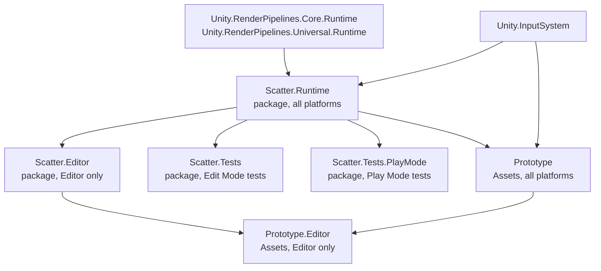
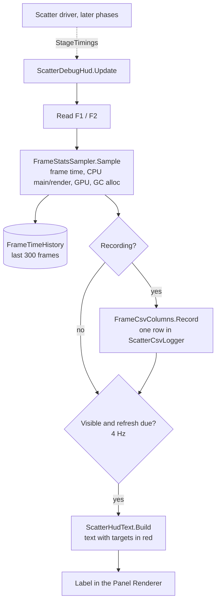
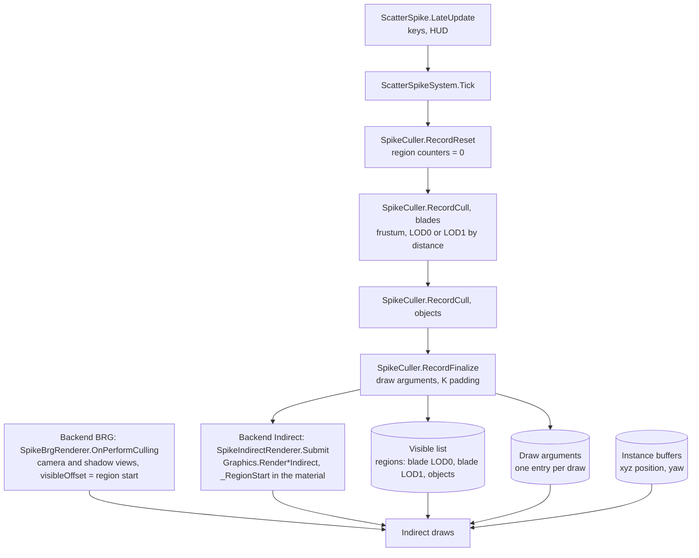

# Project Guide - GrassRendering (as built)

This guide describes **what exists today** in the repository and how it works. It is updated with each change, so it always matches the code.

- The target architecture and the reasons behind it are in the [design document](GrassPrototype_Design.md). Section numbers like "design 12.1" refer to it.
- The order of work and the progress are in the [implementation plan](GrassPrototype_Implementation.md).
- The coding rules are in [CodingRules.md](CodingRules.md).

Current state: **Phase 1 done** (spikes); next: Phase 1b (cost investigation). On top of the Phase 0 skeleton (debug tools, quality tiers, bootstrap scene, tests, build script), the BRG draw spike draws millions of blades and small rocks with three draw command types (section 4.3). The spike code is replaced in Phase 2.

---

## 1. What is built

| Area | State | Where |
|---|---|---|
| Scatter package skeleton | Done | `Packages/com.gaiagames.scatter` |
| Debug HUD and CSV logger (design 12.1) | Done: frame values. Scatter timing rows are shown as "-" until the stages exist | `Runtime/Diagnostics` |
| Quality tiers (`ScatterQuality`) | Done: assets and settings; used by the HUD targets for now | `Runtime/ScatterQuality.cs`, `Assets/Settings/Scatter` |
| Prototype scene and fly camera | Done | `Assets/Scenes/Bootstrap.unity`, `Assets/Prototype` |
| Tests and command-line runs | Done | `Tests/Editor`, `Tests/Runtime` |
| Windows build script | Done | `Assets/Prototype/Editor/PrototypeBuild.cs` |
| BRG draw spike (Phase 1, S1): spike cull, BRG backend, spike shaders, blade mesh factory | Done: three blade draw types and the rock layer drawn by BRG in all five passes | `Runtime/Rendering`, `Shaders/Spike`, `Assets/Scenes/Spike_Draw.unity` |
| Graphics.Render*Indirect baseline (S2): same draws without BRG, F9 switches | Done: same draws and shading as BRG, all five passes checked | `Runtime/Rendering/Spike/SpikeIndirectRenderer.cs` |
| Timings and K sweep (S3): URP GPU timings, scripted benchmark, GPU marker probe | Done: measurements in `Docs/Measurements/Phase1` | `Runtime/Diagnostics/UrpPassTimings.cs`, `Runtime/Rendering/Spike/SpikeBenchmark*.cs` |
| Generation, layers, terrain adapter, wind, interaction | Not started (Phases 2 to 8) | design 3 to 8 |

---

## 2. Repository layout

```
Packages/com.gaiagames.scatter/        The scatter system, as an embedded package
  package.json                         Package name, version, dependencies (URP, UI Toolkit)
  README.md                            How to use the package in another project
  Runtime/                             Assembly Scatter.Runtime
    ScatterQuality.cs                  Settings of one quality tier
    ScatterShadowMode.cs               Off / Near / All
    AssemblyInfo.cs                    Internals visible to the Edit Mode tests
    Diagnostics/                       Debug HUD, frame statistics, CSV logger
    Rendering/BladeMeshFactory.cs      Blade mesh LODs and K-blade index buffers, built by code
    Rendering/Spike/                   Phase 1 spike (namespace Scatter.Rendering.Spike), replaced in Phase 2
      Resources/                       ScatterSpikeResources asset (shaders, rock mesh; found in players too)
    Ground/ Chunks/ Compute/           Empty for now (Phases 2 to 7)
    Wind/ Interaction/
  Shaders/Spike/                       Spike cull compute, spike shaders and their HLSL includes
  Editor/                              Assembly Scatter.Editor: menu items
  Tests/Editor/                        Assembly Scatter.Tests: Edit Mode tests
  Tests/Runtime/                       Assembly Scatter.Tests.PlayMode: Play Mode tests
Assets/
  Prototype/                           Assembly Prototype: FlyCamera
  Prototype/Editor/                    Assembly Prototype.Editor: PrototypeBuild, SpikeSceneBuilder
  Scenes/Bootstrap.unity               First scene of the build
  Scenes/Spike_Draw.unity              Phase 1 BRG draw spike, second scene of the build
  Settings/                            URP assets (PC_RPAsset, PC_Renderer), volume profiles
  Settings/Scatter/                    ScatterQuality_RTX3060Ti, ScatterQuality_RTX5070Ti
Docs/                                  Design, implementation plan, this guide, coding rules
Builds/                                Player builds (ignored by git)
```

**Rule:** everything that is part of the scatter system goes in the package. Content used only by the prototype (mock terrain, test scenes, player) goes in `Assets`. The package never references `Assets`.

---

## 3. Assemblies

Each code folder has an **Assembly Definition** (`.asmdef`): Unity compiles the folder into its own DLL. This gives faster recompiles, and above all **dependencies that the compiler enforces**: an assembly can only use the assemblies it references, and references cannot form a cycle.



An arrow "A → B" means "B references A".

| Assembly | Platforms | Role |
|---|---|---|
| `Scatter.Runtime` | all | The scatter system. References RP Core, URP and the Input System. Unsafe code allowed (BRG draw commands are native pointers). |
| `Scatter.Editor` | Editor | Editor tools of the package. |
| `Scatter.Tests` | Editor | Edit Mode tests. Unsafe code allowed (reads BRG draw commands); sees the internals of `Scatter.Runtime`. |
| `Scatter.Tests.PlayMode` | all | Play Mode tests. |
| `Prototype` | all | Prototype-only runtime code. |
| `Prototype.Editor` | Editor | Prototype-only editor code (build script). |

Settings worth knowing:
- **Editor-only assemblies** (`includePlatforms: Editor`) are never compiled into players.
- **Test assemblies** compile only when the Test Framework enables tests (`defineConstraints: UNITY_INCLUDE_TESTS`). They use NUnit, and other code cannot reference them (`autoReferenced: false`).
- **`SCATTER_INPUT_SYSTEM`**: `Scatter.Runtime` defines it when the `com.unity.inputsystem` package is installed (`versionDefines`). The HUD then reads its keys with the Input System, otherwise with the legacy Input Manager, so the package compiles in both kinds of projects.
- **Namespaces** follow the assemblies: `Scatter`, `Scatter.Diagnostics`, `Scatter.Editor`, `Scatter.Tests...`, `Prototype`. Never name a namespace `Debug`: it would hide `UnityEngine.Debug`.

---

## 4. How it works

### 4.1 Target pipeline
The scatter system runs in two stages (design 3): **generation** of blade records on the GPU when a chunk needs them, and every frame a **cull compute** that fills a visible list and draw arguments, followed by a fixed set of **indirect draws**. Generation does not exist yet; the Phase 1 spike (4.3) proves the cull and drawing path (design 6.2, 6.3).

### 4.2 Diagnostics, every frame
`ScatterDebugHud` is the only per-frame component today. It drives sampling, recording and display:



| Class | Role |
|---|---|
| `ScatterDebugHud` | MonoBehaviour on the HUD prefab. Owns the objects below, handles keys, writes the CSV when recording stops or the component is disabled. |
| `FrameStatsSampler` | Reads `FrameTimingManager` (CPU and GPU times) and the profiler counter "GC Allocated In Frame" once per frame. Values not available are `NaN` (or -1 for GC). |
| `FrameStats` | Plain struct with the whole-frame values of one frame. |
| `FrameTimeHistory` | Ring buffer of frame times. Average, worst frame and 99th percentile (quickselect on a preallocated scratch array). |
| `ScatterStageTimings` | Scatter timings (CPU main, generation, cull, depth, colour, shadows, motion vectors). `NaN` = not measured yet. Set each frame by the scatter driver through `ScatterDebugHud.StageTimings`. |
| `ScatterCsvLogger` | Stores rows of numbers in a buffer allocated at construction. Recording never allocates; text is produced only when the file is written. Rows past the capacity are counted as dropped. |
| `FrameCsvColumns` | Column indices and names of the per-frame CSV, and `Record` to fill one row. Later phases append their columns here. |
| `ScatterHudText` | Builds the HUD text with a reused `StringBuilder`, from the frame values (`FrameStats`, `FrameTimeHistory`), the scatter timings and the tier. Values over the tier targets are shown in red. |
| `UrpPassTimings` | GPU time of URP's work, read through a `ProfilingSampler` of the same name as URP's marker (it shares the marker): camera (`ExecuteRenderGraph`), shadows (`MainLightShadow`) and SSAO in the Editor and in development players; depth (`DrawDepthNormalPrepass`), colour (`DrawOpaqueObjects`) and motion vectors (`DrawMotionVectors`) in the Editor only (no GPU time in players, design 12.1). Whole-pass totals. NaN when not measured (0 ms is read as not measured: `ProfilingSampler.gpuSampleCount` throws while its recorder is empty). |
| `GpuMarkerProbe` | Diagnostic: attaches a GPU recorder to every Render marker, records some frames, reports the markers with GPU time (slowest first). Run in a player with `-spikeTimingProbe` (spike scene): writes `ScatterLogs/gpu_markers_<date>.txt` and quits. Use it again after a Unity upgrade to check `UrpPassTimings`' marker names. |

Allocation rules applied here: sampling and recording never allocate (checked by tests). The HUD text does allocate a string, so it is rebuilt only at 4 Hz and only while the HUD is visible.

**UI:** the HUD is a UI Toolkit `Label` drawn by a **Panel Renderer** (the replacement for UI Document in Unity 6000.6), with `ScatterHudPanelSettings` and the `ScatterHudTheme` theme. Panel Renderer does not expose its root element publicly: the HUD registers `RegisterUIReloadCallback`, which Unity calls at once when the panel is already loaded and again after each reload; the HUD then attaches its label to the root.

A scatter driver can also show its own lines (state, keys) under the tier with `ScatterDebugHud.StatusText`. The driver sets the string only when something changes or at the stats rate, while the HUD is visible.

### 4.3 BRG draw spike (Phase 1)
Spike code, replaced in Phase 2: it answers the questions of design 6.3 (does BRG indirect work with our own buffers, which draw command type for each usage). Namespace `Scatter.Rendering.Spike`.



| Class | Role |
|---|---|
| `ScatterSpike` | MonoBehaviour driver of the scene `Spike_Draw`: settings, keys (5.3), HUD status and timings. Runs the system in `LateUpdate`, after the camera moved. |
| `ScatterSpikeSystem` | Owns everything below; creates the content at startup (4M blades, 16k rocks), the materials and the 7 draws (3 blade draw types x 2 LODs, plus the rocks) in both backends; only the draws of the selected backend and blade draw type are enabled. `Tick` culls for one camera and requests the debug counters (non-blocking readback). |
| `SpikeCuller` | Visible list (raw buffer, 4-byte indices) with its regions, region counters, draw arguments. Records the kernels of `SpikeCull.compute`: placement (R2 sequence), counter reset, cull (one atomic add per thread group and LOD, overflow guard), args finalize. |
| `SpikeBrgRenderer` | The `BatchRendererGroup`: one batch with no metadata; in `OnPerformCulling` writes the enabled draws (mesh indirect or procedural indirect) for the camera, and the shadow casters for every shadow split. Regions are addressed with `visibleOffset`. |
| `SpikeIndirectRenderer` | Baseline backend (S2): the same draws queued every frame with `Graphics.RenderMeshIndirect`, `RenderPrimitivesIndirect` and `RenderPrimitivesIndexedIndirect`. The arguments are addressed by command index (`SpikeCuller.GetCommandIndex`). |
| `BladeMeshFactory` | Blade mesh LODs (3 segments = 7 vertices, 2 = 5, 1 = 3) and the index buffer drawing K blades per instance. Kept for Phase 2. |
| `ScatterSpikeResources` | ScriptableObject with the spike shaders and the rock mesh, in the package `Resources` folder. |
| `SpikeBenchmark` | Benchmark of S3 in the scene `Spike_Draw` (command line flags `-spikeBenchmark` for the full run, `-spikeBenchmarkQuick` for a 30-second check, then quits; or F10 for the full run). If the player quits before the end, the finished cases are written to `spike_benchmark_<mode>_partial_<date>.csv`. Runs before `ScatterSpike` each frame, hides the HUD, forces the debug counters readback, writes `persistentDataPath/ScatterLogs/spike_benchmark_<date>.csv`. |
| `SpikeBenchmarkPlan`, `SpikeBenchmarkCase` | The cases, per camera view: scatter off (baseline), every backend x blade draw type x blade count (1M, 2M, 4M, K = 16), then the K sweep (2 to 64 at 4M) for each backend. |
| `SpikeBenchmarkRunner` | Applies a case and its camera view, waits the warm-up frames (60), records the measured frames (300) and summarises them. Plain class, driven once per frame. |
| `SpikeBenchmarkRecorder`, `SpikeBenchmarkResult`, `SpikeBenchmarkMetric` | Median and 99th percentile per metric: frame GPU and CPU, main and render thread, cull, URP camera, shadows and SSAO (depth, colour, motion vectors: Editor only), spike CPU, draw submission CPU (BRG culling callbacks or Graphics.Render*Indirect calls). |
| `SpikeBenchmarkCsv` | One CSV row per case, with visible blades, overflow and the environment (GPU, graphics API, resolution). |

Blade draw types (`SpikeDrawType`): **mesh indirect** (one blade mesh instance per blade), **procedural indirect** (no mesh, the blade is built from `SV_VertexID`), **procedural indexed indirect** (K blades per instance through an index buffer; the shader reads the K entries from the visible list).

Shaders (`Shaders/Spike`): `SpikeBladeMesh`, `SpikeBladeProcedural`, `SpikeObject`, each with the five passes of design 8.1. Shared code: `SpikePasses.hlsl` (the passes), `SpikeBladeInput.hlsl` and `SpikeObjectInput.hlsl` (vertex input and placement), `SpikeVisibleEntry.hlsl` (reads the visible list: through BRG with `DOTS_INSTANCING_ON`, through its own buffer otherwise), `SpikeCommon.hlsl` and `SpikeDrawDescriptor.hlsl` (constants and structs mirrored in C#).

---

## 5. Debug tools

### 5.1 Debug HUD (design 12.1)
Add it with **GameObject > Scatter > Debug HUD**, or use the one in `Bootstrap`.

| HUD group | Values |
|---|---|
| Header | Keys, current quality tier and its frame target |
| Frame | FPS, average frame time, 99th percentile, worst frame (last 300 frames), CPU frame time (main and render thread), GPU frame time, GC allocated in frame |
| Scatter timings | CPU main, generation, cull; camera, shadows, SSAO; depth, colour, motion vectors ("-" until the stage exists). In the spike scene: spike CPU, cull GPU, and URP's GPU times (whole passes, `UrpPassTimings`; depth, colour and motion vectors in the Editor only). |
| CSV recording | Rows recorded / capacity, dropped rows (only while recording) |

**Red** means the value is over the target of the current tier (`ScatterQuality`), or that a frame allocated managed memory.

Component settings: quality asset per Unity quality level, history length (300 frames), refresh rate (4 Hz), visible on start, CSV capacity (36000 frames = 10 minutes at 60 FPS), toggle and record keys.

### 5.2 CSV recording
**F2** starts recording, **F2** again stops and writes the file. Disabling the HUD also writes it.

- Location: `Application.persistentDataPath/ScatterLogs/frames_<yyyyMMdd_HHmmss>.csv`. On Windows: `%USERPROFILE%\AppData\LocalLow\GaiaGames\GrassRendering\ScatterLogs`. The Unity console logs the full path.
- One row per frame. Columns: `frame`, `frameTimeMs`, `cpuFrameMs`, `cpuMainThreadMs`, `cpuRenderThreadMs`, `gpuFrameMs`, `gcAllocatedInFrameBytes`, `scatterCpuMainMs`, `generationGpuMs`, `cullGpuMs`, `depthGpuMs`, `colourGpuMs`, `shadowsGpuMs`, `motionVectorsGpuMs`, `cameraGpuMs`, `ssaoGpuMs`. Empty cells mean "not measured".

### 5.3 Spike controls (scene `Spike_Draw`)
The spike shows its state under the HUD header, with the counters read back from the GPU (4 times per second, only while the HUD is visible): visible entries per region and entries skipped by overflow (red when > 0). The HUD timing rows show the spike CPU time and the GPU time of the cull compute.

| Key | Action |
|---|---|
| F3 | Blade draw type: mesh indirect, procedural indirect, procedural indexed indirect |
| F4 | Region offset mode: `visibleOffset` (works), window in bytes or entries (rejected by BRG on D3D12 and Vulkan: nothing drawn) |
| F5 | Blade count: 256k, 1M, 2M, 4M |
| F6 | K, blades per instance of the procedural indexed draws: 2 to 64 |
| F7 | Object layer (rocks) on or off |
| F8 | Debug views (`SpikeDebugView`, global shader value `_ScatterDebugView`, design 12.2): off; colour per draw (red, green, blue for the three blade draw types, lighter for LOD1, rocks white); main light only; ambient only; main light shadow only; diffuse term only. |
| F9 | Backend: BRG or the Graphics.Render*Indirect baseline (S2). F4 only applies to BRG. |
| F10 | Starts the full S3 benchmark (`SpikeBenchmark`). |

### 5.4 Reading the HUD values

| HUD value | Source | What it measures |
|---|---|---|
| FPS, frame, p99, worst | `Time.unscaledDeltaTime`, over the last 300 frames | Time between two frames: everything, waits included, and in the Editor the Editor's own work |
| CPU | `FrameTimingManager` `cpuFrameTime` | CPU duration of the frame, waits included. **Not** main + render: the two threads run in parallel (the main thread prepares frame N+1 while the render thread submits frame N) |
| main | `cpuMainThreadFrameTime` | Main thread, from the start of the frame until its work is done |
| render | `cpuRenderThreadFrameTime` | Render thread, from the start of its work until Present |
| GPU | `gpuFrameTime` | GPU time of the whole frame |
| Scatter CPU main | the scatter driver (`ScatterSpikeSystem.Tick` in the spike) | Our cull recording and draw submission only, not URP's rendering |
| cull, camera, shadows, SSAO, depth, colour, motion vectors | GPU recorders on profiler markers (`UrpPassTimings`) | GPU time of these markers in the last measured frame (design 12.1: depth, colour and motion vectors in the Editor only) |

Comparing with the Unity Profiler:
- **In Play Mode in the Editor, the frame contains the Editor's work**: the Scene view (which also draws the BRG blades), Inspector repaints... The Profiler shows `PlayerLoop` and `EditorLoop` apart; `FrameTimingManager` measures the whole frame. The HUD main thread is close to `PlayerLoop` + `EditorLoop`, and the GPU time includes the Scene view and the Editor UI.
- **The HUD is not per frame:** frame times are averaged over 300 frames, the text is refreshed 4 times per second, and `FrameTimingManager` and the GPU recorders report a frame a few frames late. The Profiler shows each frame.
- The HUD itself (text, UI pass) is part of the frame; hide it (F1) when measuring by eye, as the benchmark does.
- **Real numbers come from a development player** (Phase 1 S3 benchmark), without the Editor's work. In the Editor, compare with the Profiler's main thread total (with `EditorLoop`), close the Scene view, and look for the same markers in the GPU Usage module (`Scatter Cull`, `ExecuteRenderGraph`, `MainLightShadow`, `SSAO`).

### 5.5 Limits
- **GC allocated in frame** is not available in release players (shown as "-"). Check it in the Editor or in a development build.
- **CPU and GPU times** need Player Settings "Frame Timing Stats" (enabled in this project).
- **Frame Debugger:** BRG draws are listed as "Hybrid Batch Group"; the spike shader shows in the Shader section of the event, and vertex and index counts show 0 because they are in the GPU draw arguments.

---

## 6. Quality tiers

Each Unity quality level has a matching `ScatterQuality` asset. The HUD finds the asset from the current quality level (`ScatterQuality.ForQualityLevel`; levels past the end of the list use the last asset). Later phases will size the GPU buffers from these values at startup.

| Setting | RTX3060Ti (level 0, default) | RTX5070Ti (level 1) |
|---|---|---|
| Density multiplier | 0.75 | 1 |
| Ring outer distances (m) | 30, 80, 200 | 30, 80, 200 |
| Max shadow mode | All | All |
| Generation budget (chunks per frame) | 2 | 4 |
| Frame time target (ms, 99th percentile) | 16.7 | 8.3 |
| Scatter GPU budget (ms) | 2.5 | 2 |
| Generation GPU budget (ms) | 0.4 | 0.3 |
| Scatter CPU main budget (ms) | 0.5 | 0.5 |

Both quality levels use the URP asset `PC_RPAsset` for now. All values are starting points, tuned in Phase 9.

---

## 7. Prototype content

**Scene `Assets/Scenes/Bootstrap.unity`**: camera with `FlyCamera`, directional light, ground plane, debug HUD (with both quality assets). First scene of the build.

**Scene `Assets/Scenes/Spike_Draw.unity`** (Phase 1): a copy of Bootstrap with a 150 m ground and the `ScatterSpike` driver (4.3, keys in 5.3). Second scene of the build. Created again, with the spike resources asset and the BRG variants setting, by **Scatter Prototype > Create Spike Content** (`Prototype.Editor.SpikeSceneBuilder`, also from the command line with `-executeMethod Prototype.Editor.SpikeSceneBuilder.CreateSpikeContent`).

**`FlyCamera`** (Input System):

| Input | Action |
|---|---|
| W A S D | Move |
| Q / E | Down / up |
| Right mouse button | Look around |
| Shift | Move faster (x5) |
| Mouse wheel | Change the base speed (0.5 to 500 m/s) |

---

## 8. Project settings that matter

| Setting | Value | Why |
|---|---|---|
| Company / product name | GaiaGames / GrassRendering | Give `Application.persistentDataPath` (CSV folder) |
| Render pipeline | URP, `PC_RPAsset`, Forward+ renderer | design 1 |
| Colour space | Linear | |
| Windows graphics APIs | Direct3D 12, then Vulkan | Compute shaders and indirect draws |
| Frame Timing Stats | On | CPU and GPU times in players (HUD) |
| Strict shader variant matching | On | In players, a missing shader variant draws with the error shader (magenta) and logs the shader and keywords, instead of silently using the closest variant. Makes stripped variants (for example the BRG variants) visible at once. |
| `PC_Renderer` > Depth Priming Mode | Auto | SSAO (source DepthNormals) already runs a DepthNormals prepass of the blades: priming reuses that depth in the colour pass (ZTest Equal), so overlapping blades are shaded once at no extra vertex cost. Needs MSAA off (it is). On/off measured in Phase 9 (design 8.1). |
| Graphics Settings > BatchRendererGroup Variants | Keep All (`m_BrgStripping: 2`) | The default strips the `DOTS_INSTANCING_ON` variants BRG draws with when Entities Graphics is not installed (Phase 1 finding). Set by **Scatter Prototype > Create Spike Content**. |
| Active input handling | Input System only | The HUD also supports the legacy Input Manager |
| Incremental GC | On | Shorter GC pauses |
| Enter Play Mode | Without domain reload | Fast iteration. Static fields are **not** reset between plays: reset them explicitly. |
| VSync | Off in both tiers | Frame times are measured, not capped |

---

## 9. Tests

| Assembly | Mode | Tests |
|---|---|---|
| `Scatter.Tests` | Edit Mode | `FrameTimeHistoryTests` (nearest-rank percentile, few samples, wrap-around past capacity, no allocation), `ScatterCsvLoggerTests` (header and rows, `NaN` written as an empty cell, dot decimal under a comma-decimal culture, dropped rows, no allocation), `FrameStatsSamplerTests` (no allocation), `ScatterHudTextTests` (values over the tier target in red, `NaN` shown as `-`, GC allocation `-` / `0 B` / red, driver status lines after the tier), `ScatterQualityTests` (quality level clamped to the tier list, no tiers gives null), `BladeMeshFactoryTests` (vertex and index counts per LOD, same winding for every triangle, multi-blade index offsets), `SpikeCullerTests` (GPU: thread group size and descriptor size match HLSL, region capacities, argument offsets are whole commands for both command sizes, cull vs a C# reference per region, counter reset, overflow counted and never past the region, K padding, placement deterministic and even for any prefix, no allocation), `SpikeBrgRendererTests` (commands per view: camera, shadow splits, other views; region offset modes; index buffer of K-blade draws; no allocation), `ScatterSpikeSystemTests` (all regions filled, settings changes, `Tick` does not allocate, with and without the stats readback, with both backends), `SpikeBenchmarkTests` (case plan per view, median and 99th percentile, NaN skipped, no allocation, CSV with dot decimals under a comma-decimal culture), `UrpPassTimingsTests` (NaN before any frame, no allocation) |
| `Scatter.Tests.PlayMode` | Play Mode | `ScatterDebugHudTests` (samples frames; label attached by the Panel Renderer, whether the panel loads before or after the HUD; label attached again after disable and enable; `Visible` hides the label; CSV written by `StopRecording` and when the HUD is disabled while recording, header and one row per frame; the test deletes the file), `SpikeRenderTests` (renders the spike to a render texture for each backend and blade draw type: every region drawn, checked by the debug view colours, lit blades drawn, no error shader; the window offset draws nothing on raw-buffer APIs; both backends shade the same, term by term (full shading, main light, ambient, shadow, diffuse; rendered BRG, Indirect, BRG again to prove the test is repeatable, with a difference image). In players the cases containing the shadow term (full shading, main light, shadow) are ignored: known difference (Phase 1 notes). The image of each case is saved under `temporaryCachePath/SpikeRenderTests`), `SpikeBenchmarkRunnerTests` (a short benchmark on a real system: every case measured, URP pass and cull timings, visible blades, no overflow; the camera renders into a render texture because batch mode has no window), `GpuMarkerProbeTests` (a camera rendering a cube: the probe finds Render markers with GPU time) |

Conventions:
- Every per-frame entry point has an allocation test: `Assert.That(() => ..., Is.Not.AllocatingGCMemory())`. With Test Framework 1.8 it needs `using UnityEngine.TestTools.Constraints;` and the alias `using Is = UnityEngine.TestTools.Constraints.Is;`.
- GPU tests need a graphics device: never run the tests with `-nographics`.
- Play Mode tests must also pass in a player (no `UnityEditor` API in them): they run there too.

Three ways to run them:

| Run | What runs | When |
|---|---|---|
| **Edit Mode** | `Scatter.Tests` in the Editor, without Play mode. No frame loop: `Update` is not called, a `[UnityTest]` can only wait for Editor updates. | On every change (fast): pure logic, allocation tests. |
| **Play Mode in the Editor** | `Scatter.Tests.PlayMode`. The Test Runner enters Play mode in a temporary empty scene, runs the tests with the frame loop, then restores your scene. | When code depends on frames: MonoBehaviours, UI, GPU work. |
| **Play Mode in a player** | The same Play Mode tests, in a temporary Windows player that Unity builds, runs and closes; the results come back to the Editor. | Before closing a phase, and for rendering work: shader variant stripping (strict matching is on), frame timing, other player-only behaviour. |

"Enter Play Mode without domain reload" is on (section 8): static fields keep their values between Play Mode runs, test runs included. Reset static state explicitly, or a test can leak into the next one.

How to run them: **Window > General > Test Runner** in the Editor (**Run all in player** for the player run), or the command lines in the [README](../README.md#command-line).

---

## 10. Building

**Scatter Prototype > Build Windows Player** in the Editor, or `Prototype.Editor.PrototypeBuild.BuildWindows` from the command line ([README](../README.md#command-line)). It builds the enabled scenes of the build settings into `Builds/Windows/GrassRendering.exe` and exits with code 1 in batch mode if the build fails.

**Scatter Prototype > Build Spike Development Player** (`Prototype.Editor.PrototypeBuild.BuildSpikeDevelopment`): a development build of `Spike_Draw` alone, in `Builds/WindowsSpikeDevelopment`. The Frame Debugger and the Profiler of the Editor can attach to it (target dropdown at the top of their window).

---

## 11. Known issues

- The player log reports `Hidden/Universal Render Pipeline/DBufferClear shader is not supported` at startup (URP template content; decals are not used). To check in Phase 8.

---

## 12. Keeping this guide up to date

Update this guide **in the same change as the code** when you add or change a class, an assembly, a folder, a setting, a debug tool or a test. Describe what exists, not what is planned. The plan stays in the implementation plan, and the reasons stay in the design.
