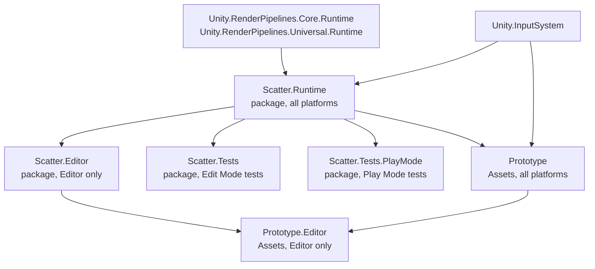
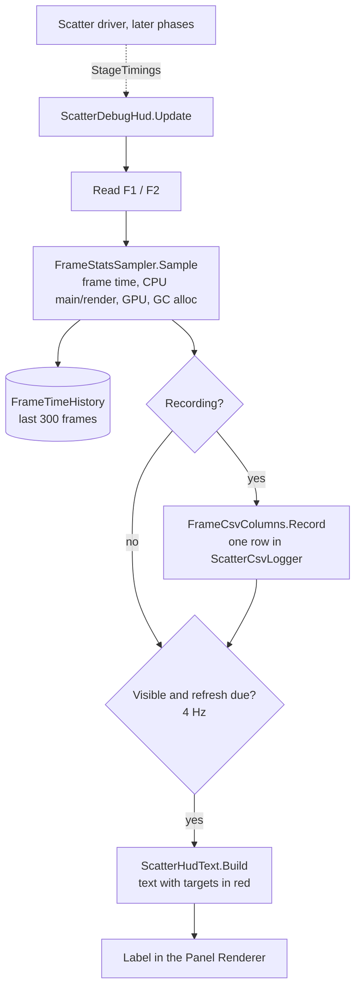

# Project Guide - GrassRendering (as built)

This guide describes **what exists today** in the repository and how it works. It is updated with each change, so it always matches the code.

- The target architecture and the reasons behind it are in the [design document](GrassPrototype_Design.md). Section numbers like "design 12.1" refer to it.
- The order of work and the progress are in the [implementation plan](GrassPrototype_Implementation.md).
- The coding rules are in [CodingRules.md](CodingRules.md).

Current state: **end of Phase 0** (project setup). The project contains the package skeleton, the debug tools that later phases will feed, the quality tiers, a bootstrap scene, the tests and the build script. No blade is drawn yet.

---

## 1. What is built

| Area | State | Where |
|---|---|---|
| Scatter package skeleton | Done | `Packages/com.gaiagames.scatter` |
| Debug HUD and CSV logger (design 12.1) | Done: frame values. Scatter timing rows are shown as "-" until the stages exist | `Runtime/Diagnostics` |
| Quality tiers (`ScatterQuality`) | Done: assets and settings; used by the HUD targets for now | `Runtime/ScatterQuality.cs`, `Assets/Settings/Scatter` |
| Prototype scene and fly camera | Done | `Assets/Scenes/Bootstrap.unity`, `Assets/Prototype` |
| Tests and command-line runs | Done | `Tests/Editor`, `Tests/Runtime` |
| Windows build script | Done | `Assets/Prototype/Editor/PrototypeBuild.cs` |
| Generation, culling, BRG drawing, layers, terrain adapter, wind, interaction | Not started (Phases 1 to 8) | design 3 to 8 |

---

## 2. Repository layout

```
Packages/com.gaiagames.scatter/        The scatter system, as an embedded package
  package.json                         Package name, version, dependencies (URP, UI Toolkit)
  README.md                            How to use the package in another project
  Runtime/                             Assembly Scatter.Runtime
    ScatterQuality.cs                  Settings of one quality tier
    ScatterShadowMode.cs               Off / Near / All
    Diagnostics/                       Debug HUD, frame statistics, CSV logger
    Ground/ Chunks/ Compute/           Empty for now (Phases 1 to 7)
    Rendering/ Wind/ Interaction/
  Shaders/                             Empty for now (Phase 1)
  Editor/                              Assembly Scatter.Editor: menu items
  Tests/Editor/                        Assembly Scatter.Tests: Edit Mode tests
  Tests/Runtime/                       Assembly Scatter.Tests.PlayMode: Play Mode tests
Assets/
  Prototype/                           Assembly Prototype: FlyCamera
  Prototype/Editor/                    Assembly Prototype.Editor: PrototypeBuild
  Scenes/Bootstrap.unity               The only scene in the build
  Settings/                            URP assets (PC_RPAsset, PC_Renderer), volume profiles
  Settings/Scatter/                    ScatterQuality_RTX3060Ti, ScatterQuality_RTX5070Ti
Docs/                                  Design, implementation plan, this guide, coding rules
Builds/                                Player builds (ignored by git)
```

**Rule:** everything that is part of the scatter system goes in the package. Content used only by the prototype (mock terrain, test scenes, player) goes in `Assets`. The package never references `Assets`.

---

## 3. Assemblies

Each code folder has an **Assembly Definition** (`.asmdef`): Unity compiles the folder into its own DLL. This gives faster recompiles, and above all **dependencies that the compiler enforces**: an assembly can only use the assemblies it references, and references cannot form a cycle.



An arrow "A → B" means "B references A".

| Assembly | Platforms | Role |
|---|---|---|
| `Scatter.Runtime` | all | The scatter system. References RP Core, URP and the Input System. |
| `Scatter.Editor` | Editor | Editor tools of the package. |
| `Scatter.Tests` | Editor | Edit Mode tests. |
| `Scatter.Tests.PlayMode` | all | Play Mode tests. |
| `Prototype` | all | Prototype-only runtime code. |
| `Prototype.Editor` | Editor | Prototype-only editor code (build script). |

Settings worth knowing:
- **Editor-only assemblies** (`includePlatforms: Editor`) are never compiled into players.
- **Test assemblies** compile only when the Test Framework enables tests (`defineConstraints: UNITY_INCLUDE_TESTS`). They use NUnit, and other code cannot reference them (`autoReferenced: false`).
- **`SCATTER_INPUT_SYSTEM`**: `Scatter.Runtime` defines it when the `com.unity.inputsystem` package is installed (`versionDefines`). The HUD then reads its keys with the Input System, otherwise with the legacy Input Manager, so the package compiles in both kinds of projects.
- **Namespaces** follow the assemblies: `Scatter`, `Scatter.Diagnostics`, `Scatter.Editor`, `Scatter.Tests...`, `Prototype`. Never name a namespace `Debug`: it would hide `UnityEngine.Debug`.

---

## 4. How it works

### 4.1 Target pipeline
The scatter system runs in two stages (design 3): **generation** of blade records on the GPU when a chunk needs them, and every frame a **cull compute** that fills a visible list and draw arguments, followed by a fixed set of **indirect draws**. None of it exists yet; Phase 1 proves the drawing path (design 6.3).

### 4.2 Diagnostics, every frame
`ScatterDebugHud` is the only per-frame component today. It drives sampling, recording and display:



| Class | Role |
|---|---|
| `ScatterDebugHud` | MonoBehaviour on the HUD prefab. Owns the objects below, handles keys, writes the CSV when recording stops or the component is disabled. |
| `FrameStatsSampler` | Reads `FrameTimingManager` (CPU and GPU times) and the profiler counter "GC Allocated In Frame" once per frame. Values not available are `NaN` (or -1 for GC). |
| `FrameStats` | Plain struct with the whole-frame values of one frame. |
| `FrameTimeHistory` | Ring buffer of frame times. Average, worst frame and 99th percentile (quickselect on a preallocated scratch array). |
| `ScatterStageTimings` | Scatter timings (CPU main, generation, cull, depth, colour, shadows, motion vectors). `NaN` = not measured yet. Set each frame by the scatter driver through `ScatterDebugHud.StageTimings`. |
| `ScatterCsvLogger` | Stores rows of numbers in a buffer allocated at construction. Recording never allocates; text is produced only when the file is written. Rows past the capacity are counted as dropped. |
| `FrameCsvColumns` | Column indices and names of the per-frame CSV, and `Record` to fill one row. Later phases append their columns here. |
| `ScatterHudText` | Builds the HUD text with a reused `StringBuilder`, from the frame values (`FrameStats`, `FrameTimeHistory`), the scatter timings and the tier. Values over the tier targets are shown in red. |

Allocation rules applied here: sampling and recording never allocate (checked by tests). The HUD text does allocate a string, so it is rebuilt only at 4 Hz and only while the HUD is visible.

**UI:** the HUD is a UI Toolkit `Label` drawn by a **Panel Renderer** (the replacement for UI Document in Unity 6000.6), with `ScatterHudPanelSettings` and the `ScatterHudTheme` theme. Panel Renderer does not expose its root element publicly: the HUD registers `RegisterUIReloadCallback`, which Unity calls at once when the panel is already loaded and again after each reload; the HUD then attaches its label to the root.

---

## 5. Debug tools

### 5.1 Debug HUD (design 12.1)
Add it with **GameObject > Scatter > Debug HUD**, or use the one in `Bootstrap`.

| HUD group | Values |
|---|---|
| Header | Keys, current quality tier and its frame target |
| Frame | FPS, average frame time, 99th percentile, worst frame (last 300 frames), CPU frame time (main and render thread), GPU frame time, GC allocated in frame |
| Scatter timings | CPU main, generation, cull, depth, colour, shadows, motion vectors ("-" until the stage exists) |
| CSV recording | Rows recorded / capacity, dropped rows (only while recording) |

**Red** means the value is over the target of the current tier (`ScatterQuality`), or that a frame allocated managed memory.

Component settings: quality asset per Unity quality level, history length (300 frames), refresh rate (4 Hz), visible on start, CSV capacity (36000 frames = 10 minutes at 60 FPS), toggle and record keys.

### 5.2 CSV recording
**F2** starts recording, **F2** again stops and writes the file. Disabling the HUD also writes it.

- Location: `Application.persistentDataPath/ScatterLogs/frames_<yyyyMMdd_HHmmss>.csv`. On Windows: `%USERPROFILE%\AppData\LocalLow\GaiaGames\GrassRendering\ScatterLogs`. The Unity console logs the full path.
- One row per frame. Columns: `frame`, `frameTimeMs`, `cpuFrameMs`, `cpuMainThreadMs`, `cpuRenderThreadMs`, `gpuFrameMs`, `gcAllocatedInFrameBytes`, `scatterCpuMainMs`, `generationGpuMs`, `cullGpuMs`, `depthGpuMs`, `colourGpuMs`, `shadowsGpuMs`, `motionVectorsGpuMs`. Empty cells mean "not measured".

### 5.3 Limits
- **GC allocated in frame** is not available in release players (shown as "-"). Check it in the Editor or in a development build.
- **CPU and GPU times** need Player Settings "Frame Timing Stats" (enabled in this project).

---

## 6. Quality tiers

Each Unity quality level has a matching `ScatterQuality` asset. The HUD finds the asset from the current quality level (`ScatterQuality.ForQualityLevel`; levels past the end of the list use the last asset). Later phases will size the GPU buffers from these values at startup.

| Setting | RTX3060Ti (level 0, default) | RTX5070Ti (level 1) |
|---|---|---|
| Density multiplier | 0.75 | 1 |
| Ring outer distances (m) | 30, 80, 200 | 30, 80, 200 |
| Max shadow mode | All | All |
| Generation budget (chunks per frame) | 2 | 4 |
| Frame time target (ms, 99th percentile) | 16.7 | 8.3 |
| Scatter GPU budget (ms) | 2.5 | 2 |
| Generation GPU budget (ms) | 0.4 | 0.3 |
| Scatter CPU main budget (ms) | 0.5 | 0.5 |

Both quality levels use the URP asset `PC_RPAsset` for now. All values are starting points, tuned in Phase 9.

---

## 7. Prototype content

**Scene `Assets/Scenes/Bootstrap.unity`**: camera with `FlyCamera`, directional light, ground plane, debug HUD (with both quality assets). It is the only scene in the build.

**`FlyCamera`** (Input System):

| Input | Action |
|---|---|
| W A S D | Move |
| Q / E | Down / up |
| Right mouse button | Look around |
| Shift | Move faster (x5) |
| Mouse wheel | Change the base speed (0.5 to 500 m/s) |

---

## 8. Project settings that matter

| Setting | Value | Why |
|---|---|---|
| Company / product name | GaiaGames / GrassRendering | Give `Application.persistentDataPath` (CSV folder) |
| Render pipeline | URP, `PC_RPAsset`, Forward+ renderer | design 1 |
| Colour space | Linear | |
| Windows graphics APIs | Direct3D 12, then Vulkan | Compute shaders and indirect draws |
| Frame Timing Stats | On | CPU and GPU times in players (HUD) |
| Strict shader variant matching | On | In players, a missing shader variant draws with the error shader (magenta) and logs the shader and keywords, instead of silently using the closest variant. Makes stripped variants (for example the BRG variants) visible at once. |
| Active input handling | Input System only | The HUD also supports the legacy Input Manager |
| Incremental GC | On | Shorter GC pauses |
| Enter Play Mode | Without domain reload | Fast iteration. Static fields are **not** reset between plays: reset them explicitly. |
| VSync | Off in both tiers | Frame times are measured, not capped |

---

## 9. Tests

| Assembly | Mode | Tests |
|---|---|---|
| `Scatter.Tests` | Edit Mode | `FrameTimeHistoryTests` (nearest-rank percentile, few samples, wrap-around past capacity, no allocation), `ScatterCsvLoggerTests` (header and rows, `NaN` written as an empty cell, dot decimal under a comma-decimal culture, dropped rows, no allocation), `FrameStatsSamplerTests` (no allocation), `ScatterHudTextTests` (values over the tier target in red, `NaN` shown as `-`, GC allocation `-` / `0 B` / red), `ScatterQualityTests` (quality level clamped to the tier list, no tiers gives null) |
| `Scatter.Tests.PlayMode` | Play Mode | `ScatterDebugHudTests` (samples frames; label attached by the Panel Renderer, whether the panel loads before or after the HUD; label attached again after disable and enable; `Visible` hides the label; CSV written by `StopRecording` and when the HUD is disabled while recording, header and one row per frame; the test deletes the file) |

Conventions:
- Every per-frame entry point has an allocation test: `Assert.That(() => ..., Is.Not.AllocatingGCMemory())`. With Test Framework 1.8 it needs `using UnityEngine.TestTools.Constraints;` and the alias `using Is = UnityEngine.TestTools.Constraints.Is;`.
- GPU tests need a graphics device: never run the tests with `-nographics`.
- Play Mode tests must also pass in a player (no `UnityEditor` API in them): they run there too.

Three ways to run them:

| Run | What runs | When |
|---|---|---|
| **Edit Mode** | `Scatter.Tests` in the Editor, without Play mode. No frame loop: `Update` is not called, a `[UnityTest]` can only wait for Editor updates. | On every change (fast): pure logic, allocation tests. |
| **Play Mode in the Editor** | `Scatter.Tests.PlayMode`. The Test Runner enters Play mode in a temporary empty scene, runs the tests with the frame loop, then restores your scene. | When code depends on frames: MonoBehaviours, UI, GPU work. |
| **Play Mode in a player** | The same Play Mode tests, in a temporary Windows player that Unity builds, runs and closes; the results come back to the Editor. | Before closing a phase, and for rendering work: shader variant stripping (strict matching is on), frame timing, other player-only behaviour. |

"Enter Play Mode without domain reload" is on (section 8): static fields keep their values between Play Mode runs, test runs included. Reset static state explicitly, or a test can leak into the next one.

How to run them: **Window > General > Test Runner** in the Editor (**Run all in player** for the player run), or the command lines in the [README](../README.md#command-line).

---

## 10. Building

**Scatter Prototype > Build Windows Player** in the Editor, or `Prototype.Editor.PrototypeBuild.BuildWindows` from the command line ([README](../README.md#command-line)). It builds the enabled scenes of the build settings into `Builds/Windows/GrassRendering.exe` and exits with code 1 in batch mode if the build fails.

---

## 11. Known issues

- The player log reports `Hidden/Universal Render Pipeline/DBufferClear shader is not supported` at startup (URP template content; decals are not used). To check in Phase 8.

---

## 12. Keeping this guide up to date

Update this guide **in the same change as the code** when you add or change a class, an assembly, a folder, a setting, a debug tool or a test. Describe what exists, not what is planned. The plan stays in the implementation plan, and the reasons stay in the design.
